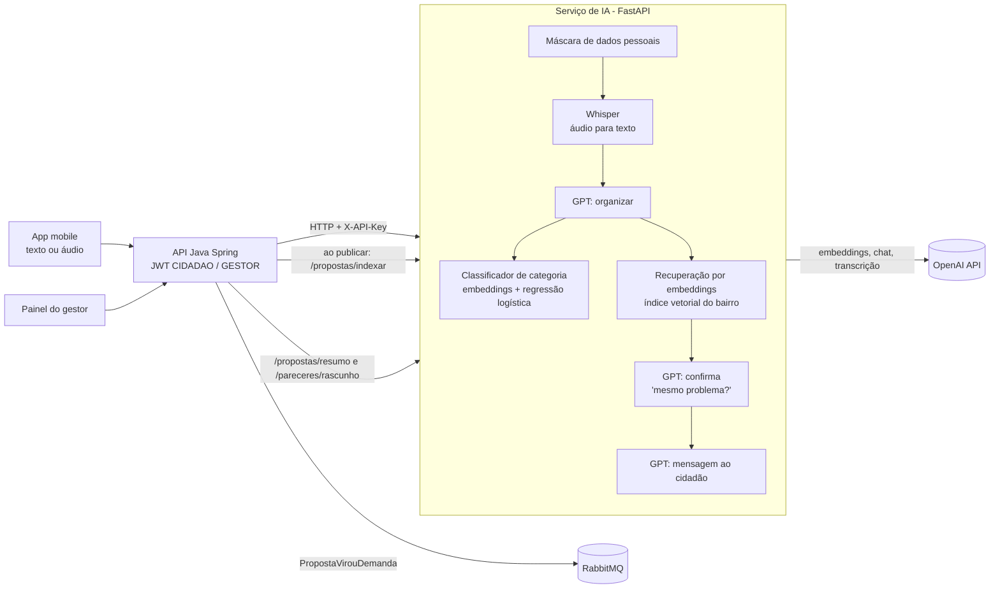
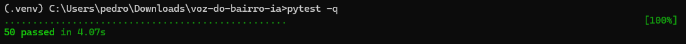
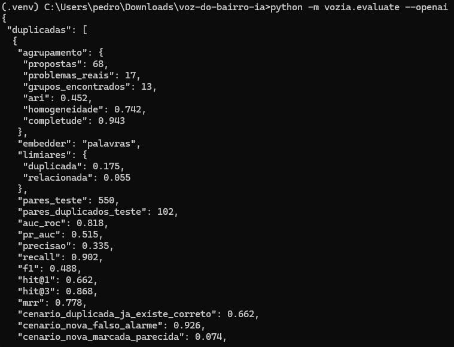

# Voz do Bairro IA

Componente de **inteligência artificial** da solução **Voz do Bairro**. Este repositório contém o serviço de IA (Python + FastAPI) que a API Java chama para transcrever propostas faladas, organizá-las, avisar sobre propostas parecidas e apoiar o gestor da prefeitura.

> **Dados e resultados.** O dataset é **sintético** (escrito pela equipe, sem dados pessoais). As métricas medem a técnica e o pipeline, não o desempenho com moradores reais.

## Sumário
1. [Integrantes](#1-integrantes)
2. [O projeto Voz do Bairro](#2-o-projeto-voz-do-bairro)
3. [Resumo em um minuto](#3-resumo-em-um-minuto)
4. [O que a IA faz e quem ela beneficia](#4-o-que-a-ia-faz-e-quem-ela-beneficia)
5. [Arquitetura e integração com o projeto](#5-arquitetura-e-integração-com-o-projeto)
6. [Modelos e tecnologias](#6-modelos-e-tecnologias)
7. [Decisões técnicas e justificativas](#7-decisões-técnicas-e-justificativas)
8. [Dados](#8-dados)
9. [Como executar](#9-como-executar)
10. [API](#10-api)
11. [Avaliação e métricas](#11-avaliação-e-métricas)
12. [Testes e situações de falha](#12-testes-e-situações-de-falha)
13. [Limitações](#13-limitações)
14. [Roteiro de demonstração](#14-roteiro-de-demonstração)
15. [Evidências de execução](#15-evidências-de-execução)
16. [Uso responsável](#16-uso-responsável)
17. [Estrutura do repositório](#17-estrutura-do-repositório)

## 1. Integrantes
| Nome | RM | Turma |
|---|---|---|
| Andrei de Paiva Gibbini | 563061 | 2TDSPF |
| Pedro Sakai Silva Zambaca | 565956 | 2TDSPF |
| Pedro Santos Pequini | 561842 | 2TDSPF |
| Arthur Câmara | 562310 | 2TDSPG |
| Diogo Cunha | 563654 | 2TDSPF |

## 2. O projeto Voz do Bairro
Moradores propõem melhorias para o bairro e a comunidade apoia. Quando uma proposta atinge o **mínimo de apoios**, ela vira uma **demanda oficial**. A partir daí a **prefeitura tem prazo** para responder: **aceita**, **recusa com justificativa** ou **agenda**. Todos acompanham se o que foi prometido saiu do papel, e cada bairro tem um **placar público** de propostas atendidas, atrasadas e ignoradas.

Para incluir quem tem dificuldade com texto (idosos, pessoas com baixa escolaridade), a proposta pode ser enviada por **áudio**. Antes de publicar, o sistema avisa se já existe uma proposta parecida ("já tem uma proposta sobre esse buraco, quer apoiar ela?"), para que os apoios não fiquem espalhados em 40 cópias da mesma coisa.

**ODS:** 11 (cidades sustentáveis), 10 (redução das desigualdades) e 16 (instituições eficazes e transparentes).

## 3. Resumo em um minuto
- **Problema:** propostas repetidas dividem os apoios e nenhuma atinge o mínimo para virar demanda; quem tem dificuldade com texto fica de fora; o gestor recebe volume sem organização.
- **Solução de IA:** o morador pode **falar** a proposta; a IA transcreve (Whisper) e organiza (GPT); antes de publicar, avisa se **já existe uma proposta parecida** no bairro; sugere a **categoria**; para o gestor, gera **resumo neutro** e **rascunho de parecer**.
- **Técnica:** IA generativa (GPT, Whisper) + **RAG em duas etapas** (embeddings recuperam candidatas, o GPT confirma "é o mesmo problema?") + **Machine Learning** (classificador de categoria sobre embeddings).
- **Resultados no conjunto de teste:** AUC 0,98 e Hit@1 0,94 na recuperação; alarme falso em propostas novas cai de 51,5% (só similaridade) para **5,9%** com a confirmação do GPT; categoria **81%**; agrupamento ARI **0,96**; teste de aceitação ponta a ponta com 40 propostas inéditas: **95%**.
- **Segurança e falhas:** dados pessoais mascarados antes do LLM, chaves só em variável de ambiente, saída do LLM validada, e se o LLM ou os embeddings caírem o serviço continua funcionando em modo reduzido.

### Ciclo da proposta e onde a IA atua
| Etapa | O que acontece | Quem faz |
|---|---|---|
| 1. Proposta (texto ou áudio) | O cidadão escreve ou fala | **IA:** transcreve, organiza, sugere categoria |
| 2. Aviso de parecida | Antes de publicar, mostra propostas semelhantes e os apoios | **IA:** detecta duplicadas |
| 3. Mínimo de apoios | A comunidade apoia | Votos e regras (.NET, Java) |
| 4. Demanda oficial e prazo | A proposta vira demanda e o prazo começa | Java, eventos (RabbitMQ) |
| 5. Resposta da prefeitura | Aceita, recusa com justificativa ou agenda | Gestor; **IA:** resumo e rascunho de parecer |
| 6. Placar do bairro | Atendidas, atrasadas e ignoradas | Oracle, MongoDB |

Sem a IA, os apoios se espalham em dezenas de cópias da mesma proposta e nenhuma atinge o mínimo para virar demanda.

## 4. O que a IA faz e quem ela beneficia
| Funcionalidade | Técnica |
|---|---|
| Transcrever a proposta falada | Whisper |
| Escrever título e descrição claros | GPT |
| Avisar se já existe proposta parecida no bairro | Embeddings + RAG + GPT confirmando |
| Agrupar propostas parecidas | Embeddings + agrupamento por ligação média |
| Sugerir a categoria (saúde, mobilidade, zeladoria, lazer) | Regressão logística sobre embeddings |
| Resumo neutro da discussão (gestor) | GPT |
| Rascunho de parecer (gestor) | GPT |

| Quem | O que ganha |
|---|---|
| **Cidadão com pouca escolaridade, idoso** | Envia a proposta por voz; a IA transcreve e escreve um título e uma descrição claros |
| **Qualquer cidadão** | Descobre proposta parecida antes de publicar e apoia em vez de duplicar; recebe sugestão de categoria |
| **Gestor da prefeitura** | Vê propostas agrupadas, lê um resumo neutro da discussão e recebe um rascunho de parecer (a decisão é dele) |
| **Comunidade** | Apoios concentrados em uma proposta, o que faz a meta ser atingida e a cobrança de prazo funcionar |

## 5. Arquitetura e integração com o projeto


### Fluxo de uma proposta
**áudio → Whisper → máscara de dados pessoais → GPT organiza → classificador sugere categoria → embeddings recuperam propostas parecidas do bairro → GPT confirma "é o mesmo problema?" → GPT escreve o aviso → o cidadão decide se publica.**

### Como a IA se integra ao projeto
- O serviço de IA é um **módulo separado** (Python/FastAPI). Só a **API Java** conversa com ele, com o cabeçalho `X-API-Key`. A chave da OpenAI fica no serviço de IA, nunca no app.
- **Cidadão:** a API Java chama `POST /audio/propostas` ou `POST /propostas/analisar` antes de publicar e mostra o aviso no app.
- **Publicação:** quando a proposta é publicada, a API Java chama `POST /propostas/indexar` e ela entra no índice do bairro (e `DELETE /propostas/{id}` quando é removida).
- **Gestor:** `POST /propostas/resumo` e `POST /pareceres/rascunho` geram rascunhos que o gestor revisa; `POST /propostas/grupos` agrupa propostas parecidas.
- **A IA nunca bloqueia o fluxo:** se ela estiver fora do ar, a API continua e o cidadão publica normalmente.
- Contrato e exemplo de cliente Java: [`docs/integracao_java.md`](docs/integracao_java.md). Fluxos detalhados e degradação segura: [`docs/arquitetura.md`](docs/arquitetura.md).

## 6. Modelos e tecnologias
| Tarefa | Modelo / técnica |
|---|---|
| Transcrição de áudio | OpenAI Whisper (`whisper-1`) |
| Organizar, mensagem, resumo, parecer, confirmação | OpenAI GPT (`gpt-4o-mini`, configurável) |
| Similaridade de propostas | Embeddings `text-embedding-3-small` + cosseno; baseline local TF-IDF de caracteres |
| Agrupamento | Aglomerativo, ligação média, distância 1 − similaridade |
| Categoria | Regressão logística sobre os embeddings |
| Serviço | Python 3.12, FastAPI, Pydantic v2, scikit-learn, NumPy, Docker, pytest |

## 7. Decisões técnicas e justificativas
- **RAG em duas etapas para duplicadas.** Embeddings recuperam candidatas rápido e barato; o LLM confirma se é *o mesmo problema*. Só com similaridade, "buraco na Rua das Flores" e "falta lixeira na Rua das Flores" ficam parecidas demais e geram falso alarme. Medimos isso: sem o GPT, 51,5% das propostas novas ainda disparavam alarme (91% no baseline lexical); com o GPT caem para 5,9%.
- **Falha segura no aviso.** Se o GPT não confirmar, o aviso usa tom cauteloso ("propostas parecidas") e nunca afirma que "já existe" sem confirmação.
- **Por que não treinar uma rede neural (Deep Learning)?** Com 144 textos, treinar uma rede do zero seria pior e mais caro que usar embeddings pré-treinados, que já são o resultado de Deep Learning. Usamos essa rede **pré-treinada** como extratora de características.
- **Por que OpenAI e não modelo local?** Qualidade em português, Whisper para áudio e custo de centavos neste volume. O trade-off é enviar texto à nuvem, mitigado por mascarar dados pessoais.
- **Por que um serviço Python separado?** O ecossistema de ML está em Python; a API Java só chama HTTP. Também mantém a chave da OpenAI fora do app.
- **O LLM não decide.** Ele escreve e confirma; ids e números citados são validados contra a fonte, e a publicação, o resumo e o parecer são sempre revisados por uma pessoa.
- **Categoria só sugere.** Abaixo de 0,50 de confiança o app pede revisão.

## 8. Dados
- **Fonte:** dataset sintético escrito pela equipe, sem dados pessoais: 144 propostas (36 problemas × 4 redações diferentes) em 4 bairros (Jardim das Acácias, Vila Nova, Centro, Parque Industrial) e 4 categorias (mobilidade, zeladoria, saúde, lazer). Inclui casos difíceis de propósito: problemas diferentes na mesma rua ou no mesmo equipamento. Arquivo: [`data/propostas.jsonl`](data/propostas.jsonl), gerado por [`scripts/gerar_dataset.py`](scripts/gerar_dataset.py).
- **Conjunto de aceitação:** 40 propostas inéditas (20 duplicadas com redação nova, 10 novas de assunto diferente, 10 novas difíceis): [`data/aceitacao.jsonl`](data/aceitacao.jsonl), gerado por [`scripts/gerar_aceitacao.py`](scripts/gerar_aceitacao.py).
- **Preparação:** máscara de dados pessoais, normalização, embeddings L2-normalizados e índice vetorial em memória, filtrado por bairro. Detalhes em [`docs/arquitetura.md`](docs/arquitetura.md).
- **Divisão:** os problemas (não as frases) são divididos em DEV e TESTE, para que nada do teste vaze para o ajuste.

## 9. Como executar
Pré-requisito: Python 3.11 ou mais novo.

**Linux/Mac**
```bash
python -m venv .venv
source .venv/bin/activate
pip install -r requirements-dev.txt
pytest                               # 50 testes, sem rede e sem chave
export AI_SERVICE_API_KEY=$(python -c "import secrets;print(secrets.token_urlsafe(32))")
export OPENAI_API_KEY=sk-...         # sem ela, roda em modo local (TF-IDF + textos-modelo)
uvicorn app.main:app --port 8000     # Swagger em http://localhost:8000/docs
python scripts/demo.py               # roda 5 casos de demonstração
```

**Windows (Prompt de Comando)**
```
python -m venv .venv
.venv\Scripts\activate
pip install -r requirements-dev.txt
pytest -q
set OPENAI_API_KEY=sk-...
python -c "import secrets;print(secrets.token_urlsafe(32))"
set AI_SERVICE_API_KEY=valor_gerado_acima
uvicorn app.main:app --port 8000
python scripts\demo.py
```

As chaves vão **somente em variáveis de ambiente** (o serviço não lê o arquivo `.env`; o [`.env.example`](.env.example) só documenta os nomes). Demo no navegador: `http://localhost:8000/demo` (texto ou gravação de voz; informe a `AI_SERVICE_API_KEY` no campo de chave).

Exemplo com `curl`:
```bash
curl -X POST localhost:8000/propostas/analisar -H "X-API-Key: $AI_SERVICE_API_KEY" -H "Content-Type: application/json" \
  -d '{"texto":"o buraco da rua das flores perto da padaria já derrubou várias motos","bairro":"Jardim das Acácias"}'
curl -X POST localhost:8000/audio/propostas -H "X-API-Key: $AI_SERVICE_API_KEY" -F "arquivo=@proposta.mp3" -F "bairro=Jardim das Acácias"
```


Regerar dados e avaliação:
```bash
python scripts/gerar_dataset.py
python scripts/gerar_aceitacao.py
python -m vozia.evaluate             # baselines locais, sem custo
python -m vozia.evaluate --openai    # inclui embeddings da OpenAI e a confirmação por GPT (leva alguns minutos)
```
Rode a avaliação com `--openai` **antes** de subir o serviço com a OpenAI: ela calibra os limiares em `models/openai/limiares.json`.

## 10. API
Todas as rotas, exceto `/health`, exigem o cabeçalho `X-API-Key` quando `AI_SERVICE_API_KEY` está definida.

| Rota | Descrição |
|---|---|
| `GET /health` | Estado do serviço (sem chave) |
| `GET /demo` | Página de demonstração (texto e voz) |
| `POST /propostas/analisar` | Organiza, sugere categoria e avisa se já existe proposta parecida |
| `POST /audio/propostas` | Igual, a partir de um áudio (multipart) |
| `POST /propostas/indexar` · `DELETE /propostas/{id}` | Mantém o índice das propostas publicadas |
| `POST /propostas/grupos` | Agrupa propostas parecidas do bairro |
| `POST /propostas/resumo` | Resumo neutro da proposta e dos comentários |
| `POST /pareceres/rascunho` | Rascunho de parecer para a decisão do gestor |

Resposta de `/propostas/analisar`: `texto_limpo`, `pii_mascarados`, `organizado` (título e descrição), `categoria` (`categoria`, `confianca`, `alternativas` e `precisa_revisao`), `decisao` (`ja_existe`, `parecidas`, `nova` ou `nao_verificado`), `mensagem_ao_cidadao`, `similares`, `modo` (`llm` ou `fallback`), `verificacao` (`llm` ou `limiar`), `aviso` e `embedder`. Swagger em `/docs`.

## 11. Avaliação e métricas
**Protocolo.** Problemas divididos em DEV (calibra limiares) e TESTE (todos os números abaixo). Embedders lexicais ajustados só no DEV. Classificador de categoria com validação cruzada agrupada por problema. Relatório completo, gráfico e falhas: [`reports/avaliacao.md`](reports/avaliacao.md) e [`reports/metricas.json`](reports/metricas.json).

**Detector de duplicadas (68 consultas de teste, 550 pares):**

| Embedder | AUC-ROC | PR-AUC | Hit@1 | Hit@3 | MRR | Duplicada detectada | Falso alarme em proposta nova |
|---|---|---|---|---|---|---|---|
| palavras | 0.818 | 0.515 | 0.662 | 0.868 | 0.778 | 0.662 | 0.926 |
| tfidf | 0.904 | 0.769 | 0.912 | 0.985 | 0.947 | 0.897 | 0.912 |
| **openai** | **0.984** | **0.934** | **0.941** | **1.0** | **0.968** | **0.941** | 0.515 (só limiar) → **0.059** com confirmação do GPT |

Confirmação do GPT (embeddings OpenAI): acurácia do veredito por candidata **0.979** (338 julgadas); duplicada confirmada **1.0**.

**Classificador de categoria** (validação cruzada agrupada por problema): TF-IDF **0.431**; embeddings da OpenAI **0.812** (baseline da classe majoritária: 0.278).

**Agrupamento de propostas parecidas** (17 problemas reais no teste): TF-IDF ARI 0.600; OpenAI **ARI 0.963**, homogeneidade 0.993, completude 0.977 (18 grupos).

**Teste de aceitação ponta a ponta** (fluxo completo do serviço, 40 propostas inéditas):

| Configuração | Acurácia | Duplicadas detectadas | Novas fáceis sem alarme | Novas difíceis sem alarme |
|---|---|---|---|---|
| TF-IDF sem LLM (fallback) | 0.675 | 18/20 | 6/10 | 3/10 |
| TF-IDF + GPT | 1.0 | 20/20 | 10/10 | 10/10 |
| OpenAI + GPT | 0.95 | 20/20 | 10/10 | 8/10 |

**Interpretação.**
- Um único limiar de similaridade não separa "mesmo problema" de "mesma rua, outro problema": mesmo com embeddings da OpenAI, 51,5% das propostas novas disparavam alarme. A confirmação pelo GPT derruba isso para **5,9%** mantendo 100% das duplicadas confirmadas. Essa é a razão da arquitetura em duas etapas.
- No teste de aceitação, o que mais reduz os falsos alarmes é a confirmação do GPT (TF-IDF vai de 67,5% para 100% ao recebê-la). A diferença entre TF-IDF + GPT (100%) e OpenAI + GPT (95%) é de 2 casos em 40, pequena demais para concluir que um embedder é melhor; os embeddings da OpenAI ganham com folga na recuperação e na categoria.
- **Falhas conhecidas:** nos 2 erros da OpenAI + GPT, propostas novas do Parque Industrial ("calçada na Rua das Indústrias" e "iluminação na pista de caminhada") foram marcadas como já existentes: o GPT confirmou como mesmo problema a "passarela sobre a rodovia para os trabalhadores". É veredito errado do LLM; por isso a decisão final de publicar é sempre do cidadão.
- **Transcrição de áudio: não medida quantitativamente** (usamos o Whisper pré-treinado e não gravamos um conjunto de áudios de referência). Está coberta por testes funcionais e de falha. O script `scripts/avaliar_audio.py` calcula o WER caso se queira medir depois.

## 12. Testes e situações de falha
**50 testes automatizados, sem rede e sem chave** (cliente OpenAI simulado). Mapa completo dos casos em [`docs/casos_de_teste.md`](docs/casos_de_teste.md). Cobrem:

| Situação | Comportamento esperado |
|---|---|
| LLM fora do ar, sem chave ou resposta inválida | Serviço continua com textos-modelo (`modo: fallback`) |
| LLM inventa id, número ou prazo | Resposta rejeitada e substituída pelo texto-modelo |
| Falso alarme (mesma rua, outro problema) | GPT rebaixa para "parecidas" |
| Embeddings fora do ar | Avisa e deixa publicar (`nao_verificado`) |
| Prompt injection no texto do cidadão | Texto tratado como dado, saída validada |
| Dados pessoais no texto | Mascarados antes do LLM e do índice |
| Áudio inválido, vazio, grande ou sem fala | Erro claro, sem derrubar o serviço |
| Chave de API errada ou entrada acima do limite | 401 / 422 |
| Busca em outro bairro | Não vaza para outros bairros |

## 13. Limitações
- Dataset sintético, pequeno (36 problemas) e escrito pela equipe: faltam gírias, textos longos e erros reais de áudio; as consultas de cada problema vêm do mesmo autor, o que tende a ser mais fácil que o mundo real.
- A transcrição não tem métrica; sotaques, ruído e fala muito rápida podem piorar o resultado.
- O LLM pode errar o veredito, confundir problemas parecidos ou resumir mal. Por isso o cidadão decide publicar, o gestor revisa resumo e parecer, e a categoria com baixa confiança vai para revisão.
- Nomes de pessoas e endereços completos escritos no texto **não** são detectados pelo mascaramento (que cobre CPF, CNPJ, RG, telefone e e-mail).
- O texto é enviado à OpenAI (nuvem).
- O índice vetorial é em memória: adequado ao volume do projeto, não a milhões de propostas.

## 14. Roteiro de demonstração
Com o serviço rodando (`uvicorn`) e a página `http://localhost:8000/demo` aberta:
1. **Proposta que já existe:** "tem um buraco enorme na rua das flores" (Jardim das Acácias). Resultado esperado: `ja_existe`, com a proposta existente e o número de apoios.
2. **Outro problema na mesma rua que já tem proposta:** "as lâmpadas dos postes da rua das flores queimaram". Resultado esperado: `ja_existe` (já há proposta de lâmpadas).
3. **Problema novo na mesma rua:** "pedimos uma lombada na rua das flores porque os carros passam muito rápido". Resultado esperado: não vira `ja_existe`. É o caso que mostra a vantagem do GPT confirmando o "mesmo problema".
4. **Proposta nova:** "queremos aulas gratuitas de xadrez para aposentados na praça". Resultado esperado: `nova`, sem alerta.
5. **Dado pessoal:** um texto com telefone. O telefone é mascarado (`PII mascarados: 1`).
6. **Áudio:** gravar uma proposta pelo botão de voz; a transcrição aparece e a proposta é analisada.
7. **Falha:** subir o serviço sem `OPENAI_API_KEY`: tudo continua funcionando com `modo: fallback` e mensagem cautelosa; o áudio informa que a transcrição está indisponível.

`python scripts/demo.py` roda os casos 1 a 5 no terminal.

## 15. Evidências de execução
Prints da execução real (as chaves nunca aparecem). Arquivos em [`docs/evidencias/`](docs/evidencias/).

| # | Evidência | Arquivo |
|---|---|---|
| 1 | 50 testes automatizados passando |  |
| 2 | Execução de `python -m vozia.evaluate --openai` (início da saída, com o baseline de palavras; os resultados completos estão em `reports/avaliacao.md`) |  |

Gráfico das curvas do detector de duplicadas: [`docs/figures/duplicadas.png`](docs/figures/duplicadas.png).

## 16. Uso responsável
- **Credenciais:** `OPENAI_API_KEY` e `AI_SERVICE_API_KEY` só por variável de ambiente; `.env` no `.gitignore`; só `.env.example` no repositório. A chave da OpenAI nunca vai ao app.
- **Dados pessoais (LGPD):** CPF, CNPJ, RG, telefone e e-mail são mascarados antes de qualquer envio ao LLM e antes de entrar no índice; o autor da proposta não é enviado à IA; comentários não são armazenados pelo serviço. **Limite:** nomes e endereços completos escritos no texto não são detectados.
- **Prompt injection:** o texto do cidadão vai como dado delimitado, com `<` e `>` removidos, e a saída é validada.
- **Humano no controle:** o cidadão decide publicar; o gestor revisa resumo e parecer; o LLM não toma decisões nem inventa prazos.
- **Falha segura:** sem LLM, o serviço continua com textos-modelo; sem embeddings, avisa e deixa publicar.

## 17. Estrutura do repositório
```
vozia/      núcleo: config, privacy, embeddings, store, similar, categoria, llm, fallback, transcribe, servico, bootstrap, evaluate
app/        API FastAPI, contratos (schemas) e página /demo
data/       propostas.jsonl, aceitacao.jsonl, audios/
models/     limiares calibrados (os artefatos pesados são gerados na 1ª execução)
tests/      50 testes
reports/    avaliação (avaliacao.md) e métricas (metricas.json)
docs/       arquitetura, integração Java, casos de teste, figuras, evidências
scripts/    gerar_dataset, gerar_aceitacao, demo, avaliar_audio
            requirements*.txt, .env.example
```
