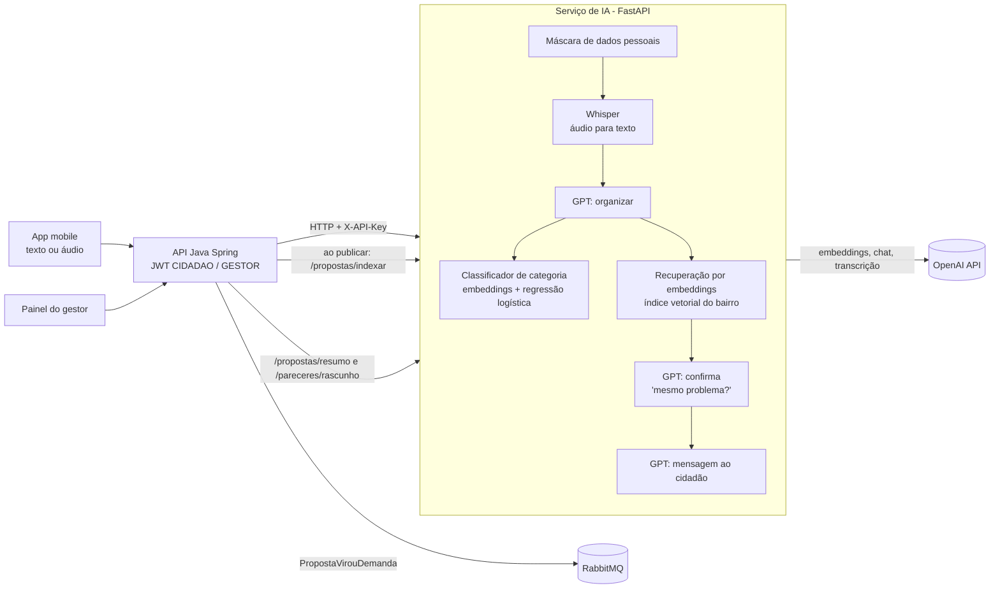

# Arquitetura, dados e fluxos

## Visão geral

## Fluxo 1: cidadão cria uma proposta (texto ou áudio)
1. O app envia o texto (`POST /propostas/analisar`) ou o áudio (`POST /audio/propostas`) para a API Java, que repassa ao serviço de IA.
2. **Áudio:** o Whisper transcreve (pt-BR). Formato, tamanho e presença de fala são validados.
3. **Privacidade:** CPF, CNPJ, RG, telefone e e-mail viram `[CPF]`, `[TELEFONE]`... antes de qualquer envio ao LLM.
4. **Organizar (IA generativa):** o GPT devolve título e descrição claros, sem inventar nada.
5. **Categoria (ML):** regressão logística sobre os embeddings sugere saúde, mobilidade, zeladoria ou lazer. Se a confiança for menor que 0,50, o app pede revisão.
6. **Duplicadas (RAG em duas etapas):**
   - *Recuperação:* o embedding do texto é comparado (cosseno) às propostas publicadas **do mesmo bairro**; as 3 mais parecidas acima do limiar "relacionada" são candidatas.
   - *Confirmação:* o GPT recebe só o texto novo e as candidatas e diz, para cada uma, se é o **mesmo problema**. Problemas diferentes na mesma rua ficam só como "relacionada".
7. **Mensagem:** o GPT redige o aviso ("já existe uma proposta sobre esse buraco, quer apoiar?"), citando apenas propostas recuperadas; ids e números são validados.
8. Resposta: decisão (`ja_existe`, `parecidas`, `nova`, `nao_verificado`), mensagem, categoria sugerida e lista de similares. **Quem decide publicar é sempre o cidadão.**

## Fluxo 2: proposta publicada
A API Java chama `POST /propostas/indexar` (por exemplo, no consumidor do evento de publicação) com id, bairro, título, texto, categoria e apoios. Ela chama de novo ao mudar os apoios, e `DELETE /propostas/{id}` quando a proposta é removida.

## Fluxo 3: gestor
- `POST /propostas/resumo`: resumo neutro da proposta e dos comentários, com pontos a favor e preocupações.
- `POST /pareceres/rascunho`: rascunho de parecer para **a decisão que o gestor já tomou** (aceita, recusa com justificativa, agenda com prazo). O LLM não decide nada e não pode inventar prazos.
- `POST /propostas/grupos`: agrupa propostas parecidas do bairro.

## Degradação segura
| Falha | Comportamento |
|---|---|
| LLM fora do ar, sem chave ou resposta inválida | texto-modelo determinístico (`modo: "fallback"`); a decisão de duplicada usa só o limiar |
| Embeddings fora do ar | `decisao: "nao_verificado"` com aviso; o cidadão ainda pode publicar |
| Áudio inválido ou sem fala | `400` com o motivo; sugere enviar em texto |
| Transcrição fora do ar | `503` pedindo para enviar em texto |

## Dados
| Fonte | Uso | Observações |
|---|---|---|
| `data/propostas.jsonl` | 144 propostas escritas pela equipe, 36 problemas × 4 formas de escrever, 4 bairros, 4 categorias | **Sintéticas**, sem dados pessoais (teste automático garante). Inclui estilo formal e coloquial/áudio transcrito e **negativos difíceis** (mesma rua ou equipamento, problemas diferentes) |
| Propostas publicadas (produção) | Índice vetorial por bairro | Chegam da API Java por `/propostas/indexar` |
| Comentários (produção) | Resumo neutro | Chegam no corpo de `/propostas/resumo`, não ficam guardados |

**Preparação:** `scripts/gerar_dataset.py` gera o JSONL; `vozia/privacy.py` mascara dados pessoais; o TF-IDF é ajustado apenas com textos de treino; os embeddings da OpenAI são normalizados (norma 1).

**Divisão dos dados (sem vazamento):** os problemas são divididos em DEV e TESTE. Os limiares são calibrados no DEV e todos os números reportados vêm do TESTE; o classificador usa validação cruzada agrupada por problema.
