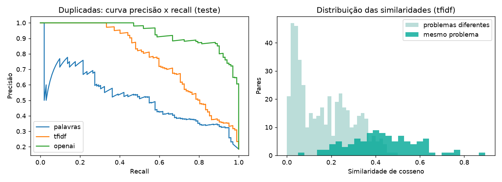

# Avaliação da IA do Voz do Bairro

> Dataset **sintético** (144 propostas escritas à mão, 36 problemas, 4 bairros). Os números medem o pipeline e a técnica; não são desempenho em produção.

Protocolo: problemas divididos em DEV (calibra limiares) e TESTE (todos os números abaixo); embedders lexicais ajustados só no DEV; classificador com validação cruzada agrupada por problema.

## 1. Detector de duplicadas (recuperação por embeddings)

| Embedder | AUC-ROC | PR-AUC | Precisão | Recall | F1 | Hit@1 | Hit@3 | MRR |
|---|---|---|---|---|---|---|---|---|
| palavras | 0.818 | 0.515 | 0.335 | 0.902 | 0.488 | 0.662 | 0.868 | 0.778 |
| tfidf | 0.904 | 0.769 | 0.374 | 0.892 | 0.528 | 0.912 | 0.985 | 0.947 |
| openai | 0.984 | 0.934 | 0.8 | 0.902 | 0.848 | 0.941 | 1.0 | 0.968 |

Pares de teste: 550 (102 do mesmo problema). Consultas de teste: 68.

### Cenários de uso (consulta contra o índice do bairro)

| Embedder | Limiar duplicada | Duplicada detectada (top-1 certo) | Nova com falso alarme | Nova marcada só como parecida |
|---|---|---|---|---|
| palavras | 0.175 | 0.662 | 0.926 | 0.074 |
| tfidf | 0.23 | 0.897 | 0.912 | 0.088 |
| openai | 0.588 | 0.941 | 0.515 | 0.279 |

### Etapa 2: LLM confirma o 'mesmo problema' (openai + GPT)

- Acurácia do veredito por candidata: **0.979** (338 julgadas)
- Duplicada confirmada: **1.0**
- Falso alarme em proposta nova: **0.059**

### Agrupamento de propostas parecidas (ligação média, mesmo limiar de 'duplicada', só TESTE)

| Embedder | Propostas | Problemas reais | Grupos encontrados | ARI | Homogeneidade | Completude |
|---|---|---|---|---|---|---|
| palavras | 68 | 17 | 13 | 0.452 | 0.742 | 0.943 |
| tfidf | 68 | 17 | 16 | 0.6 | 0.848 | 0.948 |
| openai | 68 | 17 | 18 | 0.963 | 0.993 | 0.977 |

### Teste de aceitação: fluxo completo com 40 propostas inéditas (`data/aceitacao.jsonl`)

20 duplicadas com redação nova, 10 novas de assunto diferente e 10 novas *difíceis* (mesma rua/equipamento, problema diferente).

| Configuração | Acurácia | Duplicadas detectadas | Top-1 certo | Novas fáceis sem alarme | Novas difíceis sem alarme |
|---|---|---|---|---|---|
| tfidf (fallback, sem LLM) | 0.675 | 18/20 | 20/20 | 6/10 | 3/10 |
| tfidf + GPT juiz | 1.0 | 20/20 | 20/20 | 10/10 | 10/10 |
| openai + GPT juiz | 0.95 | 20/20 | 20/20 | 10/10 | 8/10 |

Falhas (tfidf (fallback, sem LLM)):
- [nova_facil] “Instalar um bicicletário seguro no terminal de ônibus do Jardim das Acácias” → ja_existe; mais parecida: “A marcação de consultas no posto do Jardim das Acácias demora mais de três meses”
- [nova_facil] “Construir uma quadra de vôlei de areia no Parque Industrial” → ja_existe; mais parecida: “Construir passarela sobre a rodovia para os trabalhadores do Parque Industrial…”
- [nova_dificil] “Falta bebedouro na quadra esportiva da Vila Nova” → ja_existe; mais parecida: “A quadra esportiva da Vila Nova está sem rede, sem tabela e com o piso rachado”

Falhas (openai + GPT juiz):
- [nova_dificil] “A Rua das Indústrias precisa de calçada, os trabalhadores andam no meio da rua” → ja_existe; mais parecida: “Construir passarela sobre a rodovia para os trabalhadores do Parque Industrial…”
- [nova_dificil] “Instalar iluminação na pista de caminhada do Parque Industrial” → ja_existe; mais parecida: “Construir passarela sobre a rodovia para os trabalhadores do Parque Industrial…”

### Falsos alarmes (exemplos)

- (palavras, similaridade 0.441) “O semáforo do cruzamento da Avenida Brasil com a Rua das Flores está apagado há uma semana.” × “Consertar o passeio da Rua das Flores e colocar rampa para cadeirantes.”
- (palavras, similaridade 0.24) “o sinal da avenida brasil não funciona, as crianças da escola atravessam correndo” × “Os brinquedos da Praça das Acácias estão quebrados e enferrujados, as crianças se machucam.”
- (palavras, similaridade 0.461) “Cruzamento sem semáforo funcionando na Avenida Brasil esquina com a Rua das Flores, urgente.” × “Consertar o passeio da Rua das Flores e colocar rampa para cadeirantes.”
- (tfidf, similaridade 0.232) “O semáforo do cruzamento da Avenida Brasil com a Rua das Flores está apagado há uma semana.” × “a luz da rua das flores apagou tudo, não dá pra andar a noite”
- (tfidf, similaridade 0.307) “o sinal da avenida brasil não funciona, as crianças da escola atravessam correndo” × “Pedimos vacinação das crianças dentro das escolas do Jardim das Acácias.”
- (tfidf, similaridade 0.274) “O ponto de ônibus da Rua XV de Novembro não tem cobertura, idosos esperam no sol e na chuva.” × “tem carro parado na calçada da xv de novembro, a gente tem que andar na rua”
- (openai, similaridade 0.627) “O semáforo do cruzamento da Avenida Brasil com a Rua das Flores está apagado há uma semana.” × “Os postes da Rua das Flores estão com a lâmpada queimada, a rua fica escura à noite.”
- (openai, similaridade 0.602) “Solicito a instalação de cobertura e banco no ponto de ônibus da Rua XV de Novembro.” × “Pedimos fiscalização de estacionamento irregular na calçada da XV de Novembro.”
- (openai, similaridade 0.712) “A calçada da Rua das Flores está toda quebrada, cadeirante não consegue passar.” × “Tem um buraco enorme na Rua das Flores, em frente à padaria, e já quebrou roda de carro.”

## 2. Classificador de categoria (validação cruzada agrupada por problema)

| Embedder | Acurácia | F1 macro | Baseline (classe majoritária) |
|---|---|---|---|
| palavras | 0.431 | 0.423 | 0.278 |
| tfidf | 0.431 | 0.429 | 0.278 |
| openai | 0.812 | 0.82 | 0.278 |

Embeddings lexicais acertam pouco porque a categoria é **semântica**: um problema novo usa palavras que o treino nunca viu. Embeddings semânticos são o caminho esperado para essa tarefa; por segurança o serviço só *sugere* a categoria e pede revisão quando a confiança é baixa (< 0,50).

## 3. Situações de falha testadas (pytest)

LLM fora do ar, resposta do LLM inválida, id ou número inventado pelo LLM, tentativa de prompt injection, embeddings fora do ar, áudio inválido/vazio/grande/sem fala, entrada acima do limite, chave de API errada, dados pessoais no texto. Veja `tests/`.

## 4. Limitações

- A transcrição de áudio (Whisper pré-treinado) **não foi medida quantitativamente** (sem conjunto de áudios de referência); só testes funcionais e de falha.
- Poucos problemas (36) e textos curtos escritos pela equipe: faltam gírias, textos longos e erros reais de áudio.
- Todas as consultas de cada problema vêm do mesmo autor do dataset: tende a ser mais fácil que o mundo real.
- O LLM pode errar o veredito; por isso a decisão final de publicar é sempre do cidadão e o resumo/parecer são rascunhos.
- Nomes de pessoas e endereços completos não são detectados pelo mascaramento de dados pessoais.
